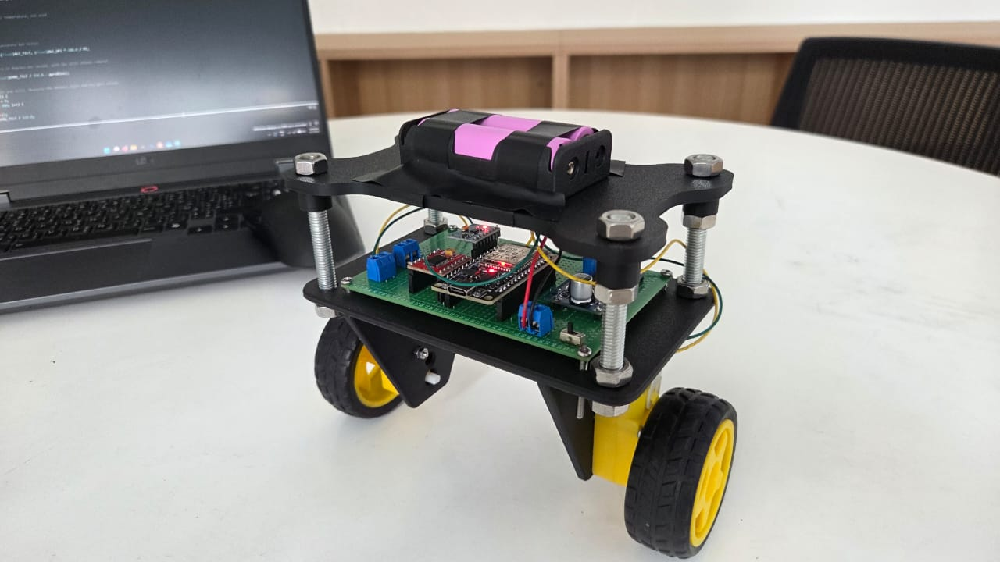
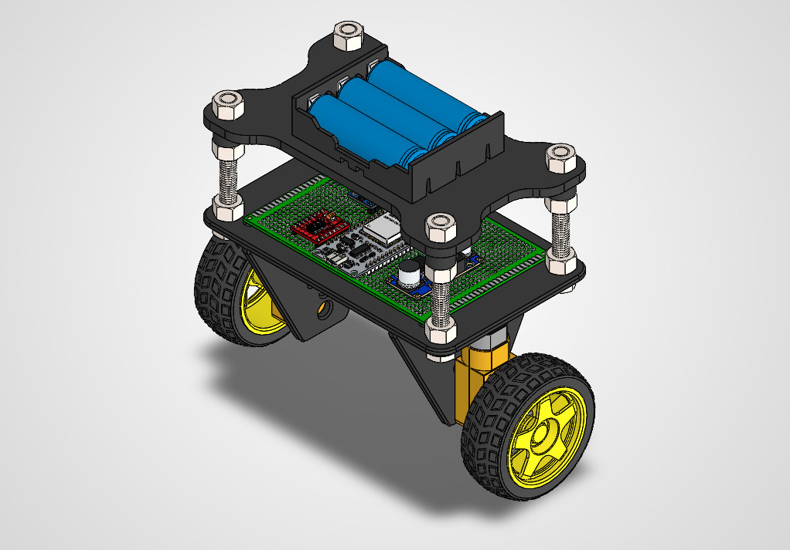
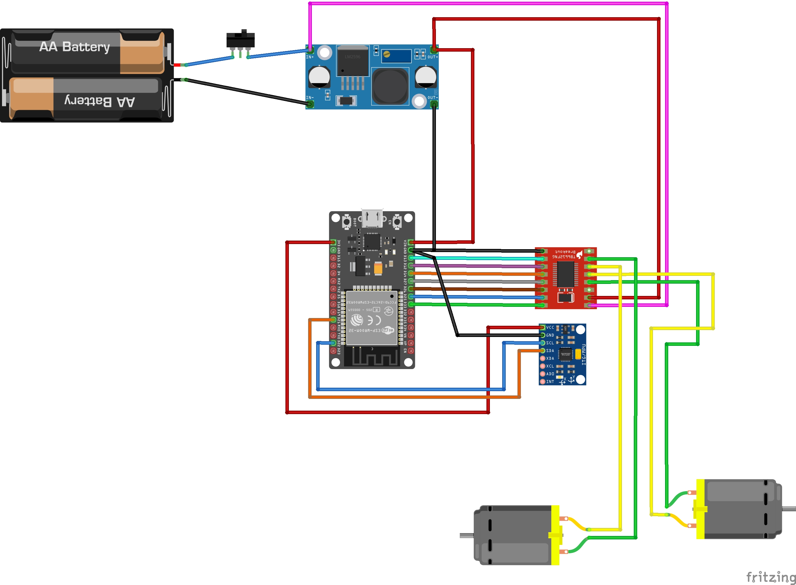

# ESP32-Self-Balancing-Robot 

An independently developed two-wheel self-balancing robot built from scratch over one month. This project combines mechanical design, electronics, embedded programming, sensor fusion, and PID control using an ESP32.

The goal was to apply my Electrical and Electronics Engineering knowledge to a practical robotics project and gain hands-on experience with hardware and software integration.

## Project Demonstration

<!-- Add your demonstration video link here -->

## Mechanical Design

The robot's mechanical structure was designed in **SolidWorks** and manufactured using 3D printing.

The design consists of:
- Custom-designed robot frame.
- Two-wheel differential drive system.
- Two TT DC geared motors.
- Electronic components mounted on a perfboard.
- Battery holder mounted on the upper platform.

## Hardware Components

| Component | Purpose |
|---|---|
| ESP32 | Main microcontroller |
| MPU6050 | Accelerometer and gyroscope for tilt measurement |
| TB6612FNG | Dual DC motor driver |
| 2 × TT DC geared motors | Robot movement and balance correction |
| Battery pack | Power supply |
| DC-DC buck converter | Voltage regulation |
| Perfboard | Circuit assembly and component connections |

The electronic circuit was assembled and soldered manually onto a perfboard.

## Circuit Design

The wiring diagram illustrates the connections between the ESP32, MPU6050, TB6612FNG motor driver, motors, and power supply.

### Main connections

**MPU6050 to ESP32 (I2C)**

| MPU6050 | ESP32 |
|---|---|
| SDA | GPIO 21 |
| SCL | GPIO 22 |
| VCC | 3.3V |
| GND | GND |

**TB6612FNG to ESP32**

| TB6612FNG signal | ESP32 GPIO |
|---|---|
| STBY | 27 |
| AIN1 | 26 |
| AIN2 | 25 |
| PWMA | 33 |
| BIN1 | 14 |
| BIN2 | 12 |
| PWMB | 13 |

The motor driver controls the direction and speed of both motors through digital direction signals and PWM outputs.

## Software and Control System

The robot runs on an ESP32 programmed using the Arduino framework.

The control system continuously measures the robot's tilt angle and adjusts the motors to maintain an upright position.

### 1. Sensor Reading and Calibration

The MPU6050 provides accelerometer and gyroscope measurements through I2C communication.

At startup, the system:
- Measures the gyroscope's resting offset.
- Calculates the initial balance setpoint.
- Initializes the filtered tilt angle.

### 2. Sensor Fusion

A complementary filter combines the accelerometer and gyroscope readings to estimate the robot's tilt angle.

The filter uses:
- 99% gyroscope contribution.
- 1% accelerometer contribution.

This helps reduce accelerometer noise while limiting the long-term drift associated with gyroscope integration.

### 3. PID Controller

A PID controller calculates the correction required to keep the robot upright.

The controller consists of three terms:

- **Proportional (Kp):** Responds to the current tilt error.
- **Integral (Ki):** Accumulates the error over time.
- **Derivative (Kd):** Uses the filtered gyroscope rate to provide damping.

The PID output determines the direction and PWM speed of the motors.

I manually tuned the Kp, Ki, and Kd parameters through repeated testing to achieve stable balancing.

### 4. Motor Control and Safety

The ESP32 sends direction and PWM signals to the TB6612FNG motor driver.

Additional control features include:
- Individual motor direction configuration.
- PWM compensation for motor dead zones.
- Motor output limits.
- Automatic motor shutdown when the tilt angle exceeds 35 degrees.

## Control System Parameters

| Parameter | Value |
|---|---|
| Microcontroller | ESP32 |
| Sensor | MPU6050 |
| Communication | I2C |
| I2C address | 0x68 |
| Control loop interval | 5 ms |
| Control loop frequency | Approximately 200 Hz |
| Sensor fusion | Complementary filter |
| Gyroscope contribution | 99% |
| Accelerometer contribution | 1% |
| Motor driver | TB6612FNG |
| Control algorithm | PID |

### PID Gains

The tuned values currently used in the code are:

| Parameter | Value |
|---|---:|
| Kp | 9.0 |
| Ki | 150.0 |
| Kd | 0.2 |

These values are specific to the current robot configuration.

## Challenges and Troubleshooting

One of the main challenges occurred during the initial hardware testing.

The circuit would not power on. Using a multimeter, I systematically checked the connections and eventually identified a solder joint that was not conducting properly.

After fixing the connection, the circuit powered on successfully.

Other challenges included:
- Identifying the correct MPU6050 sensor axes.
- Calibrating the balance setpoint.
- Correcting motor direction configurations.
- Reducing sensor noise.
- Tuning PID parameters to achieve stable balancing.

These challenges provided practical experience in debugging, electronics testing, and control system development.

## Results

The completed robot can balance independently using real-time sensor measurements and PID-based motor corrections.

The project brought together mechanical design, circuit assembly, embedded programming, and feedback control in a single working system.

## Future Improvements

- Develop a mobile phone interface to control the robot wirelessly.
- Explore Bluetooth and Wi-Fi communication using the ESP32.
- Implement remote monitoring of the robot's tilt angle and PID parameters.
- Improve balancing stability and movement control.

## Technologies and Tools

- **Mechanical Design:** SolidWorks
- **Programming:** C/C++ (Arduino framework)
- **Microcontroller:** ESP32
- **Sensors:** MPU6050
- **Motor Driver:** TB6612FNG
- **Control Theory:** PID Control
- **Communication:** I2C
- **Electronics:** Perfboard assembly and soldering

---

**Developed independently as a personal engineering project.**

*Designed, assembled, programmed, tested, and debugged by me.*
