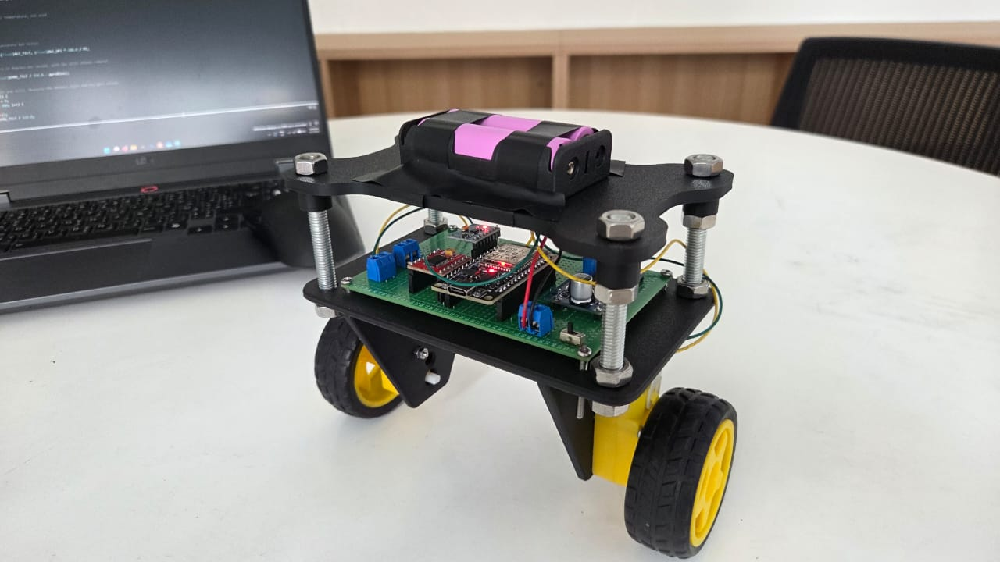
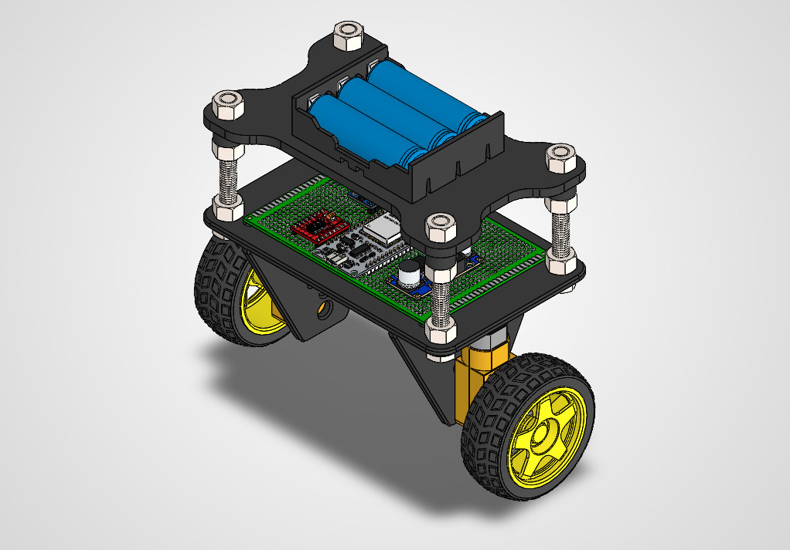
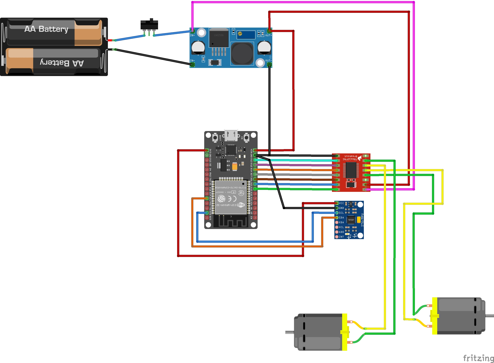

# ESP32-Self-Balancing-Robot

A two-wheeled self-balancing robot that I built from scratch in one month. It combines mechanical design, electronics, embedded code and PID control on an ESP32.

I built it to put my Electrical and Electronics Engineering coursework to practical use and to get hands-on experience with hardware and software together.

## Project demonstration

Demo video: [add link here]

## Mechanical design

I designed the frame in **SolidWorks** and 3D printed it.

The design has:
- A custom robot frame.
- A two-wheel differential drive.
- Two TT DC geared motors.
- The electronics on a perfboard.
- A battery holder on the upper platform.

## Hardware components

| Component | Purpose |
|---|---|
| ESP32 | Main microcontroller |
| MPU6050 | Accelerometer and gyroscope for tilt measurement |
| TB6612FNG | Dual DC motor driver |
| 2 × TT DC geared motors | Move the robot and correct its balance |
| 2 × 18650 Li-ion cells in series | 7.4V power supply |
| LM2596 buck converter | Steps the battery voltage down to 5V for the logic |
| SPST toggle switch | Main power switch |
| Perfboard | Circuit assembly and connections |

I assembled and soldered the circuit on the perfboard myself.

## Circuit design

The wiring diagram shows how the ESP32, MPU6050, TB6612FNG, motors and power supply connect.

### Main connections

MPU6050 to ESP32 (I2C):

| MPU6050 | ESP32 |
|---|---|
| SDA | GPIO 21 |
| SCL | GPIO 22 |
| VCC | 3.3V |
| GND | GND |

TB6612FNG to ESP32:

| TB6612FNG signal | ESP32 GPIO |
|---|---|
| STBY | 27 |
| AIN1 | 26 |
| AIN2 | 25 |
| PWMA | 33 |
| BIN1 | 14 |
| BIN2 | 12 |
| PWMB | 13 |

The direction pins set which way each motor turns, and the PWM pins set how fast.

### Power

The two 18650 cells give 7.4V. That voltage goes straight to the motor supply of the TB6612FNG. The LM2596 steps it down to 5V for the logic, and the ESP32 supplies 3.3V to the MPU6050. All parts share a common ground. A toggle switch on the positive battery wire turns the whole robot on and off.

## Software and control system

The robot runs on an ESP32 programmed with the Arduino framework. The code measures the tilt angle over and over and adjusts the motors to keep the robot upright.

### 1. Sensor reading and calibration

The MPU6050 sends accelerometer and gyroscope data over I2C.

At startup, the code:
- Measures the gyroscope's resting offset.
- Calculates the initial balance setpoint.
- Initializes the filtered tilt angle.

### 2. Sensor fusion

A complementary filter combines the accelerometer and gyroscope readings into one tilt angle. It uses 99% gyroscope and 1% accelerometer. The gyroscope dominates because the accelerometer is noisy. The small accelerometer share keeps the gyroscope's drift from building up over time.

### 3. PID controller

A PID controller calculates the correction needed to keep the robot upright.

- Proportional (Kp): reacts to the current tilt error.
- Integral (Ki): adds up the error over time.
- Derivative (Kd): uses the filtered gyroscope rate to damp the motion.

The PID output sets the direction and PWM speed of the motors. I tuned Kp, Ki and Kd by hand through repeated testing until the robot stayed upright.

### 4. Motor control and safety

The ESP32 sends direction and PWM signals to the TB6612FNG.

Other control features:
- Separate direction settings for each motor.
- PWM compensation for motor dead zones.
- Limits on the motor output.
- Automatic motor shutdown when the tilt angle exceeds 35 degrees.

## Control system parameters

| Parameter | Value |
|---|---|
| Microcontroller | ESP32 |
| Sensor | MPU6050 |
| Communication | I2C |
| I2C address | 0x68 |
| Control loop interval | 5 ms |
| Control loop frequency | Approximately 200 Hz |
| Sensor fusion | Complementary filter |
| Gyroscope contribution | 99% |
| Accelerometer contribution | 1% |
| Motor driver | TB6612FNG |
| Control algorithm | PID |

### PID gains

The values currently in the code:

| Parameter | Value |
|---|---:|
| Kp | 9.0 |
| Ki | 150.0 |
| Kd | 0.2 |

These values fit my robot's weight, wheels and motors. A different build will need its own tuning.

## How to run it

1. Install the Arduino IDE and add ESP32 board support.
2. [List any libraries the sketch needs, or delete this line.]
3. Open the sketch from this repository.
4. Select your ESP32 board and port, then upload.
5. Hold the robot upright and still while it starts, because it calibrates at startup.

## Challenges and troubleshooting

The circuit would not power on during the first hardware test. I checked the connections with a multimeter and found one solder joint that did not conduct. After I fixed it, the circuit powered on.

Other problems I worked through:
- Identifying the correct MPU6050 axes.
- Calibrating the balance setpoint.
- Correcting the motor directions.
- Reducing sensor noise.
- Tuning the PID gains until the robot balanced.

## Results

The robot balances on its own, even when left alone for over a minute. The control loop runs at about 200 Hz.

## Future improvements

- Add a phone interface to control the robot wirelessly. This will be my first IoT step.
- Try Bluetooth and Wi-Fi communication on the ESP32.
- Monitor the tilt angle and PID values remotely.
- Improve balancing stability and movement control.

## Technologies and tools

- Mechanical design: SolidWorks
- Programming: C/C++ (Arduino framework)
- Microcontroller: ESP32
- Sensor: MPU6050
- Motor driver: TB6612FNG
- Control theory: PID control
- Communication: I2C
- Electronics: perfboard assembly and soldering

Designed, built, programmed and tested by me as a personal engineering project.
